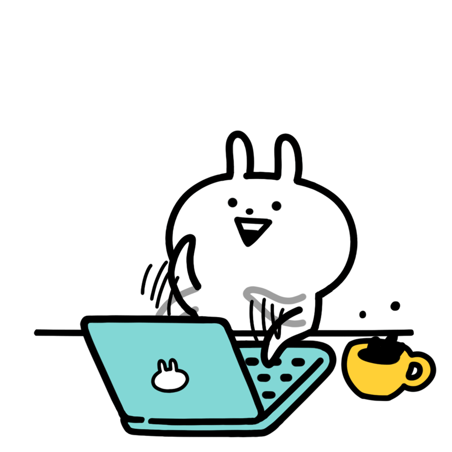
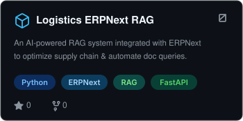
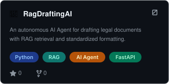
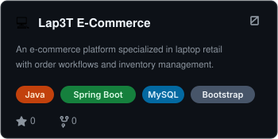
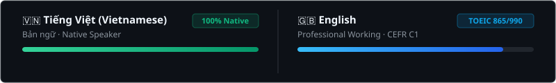

<table width="100%">
  <tr>
    <td width="220" align="center" valign="middle">
      
    </td>
    <td width="1000" align="center" valign="middle">
      <h1><b>Cap Kim Khanh</b></h1>
      <h3><b>Software Engineer &middot; AI Engineer</b></h3>
    </td>
  </tr>
</table>

### Tech Stack

| BE & FE | AI & Data | DevOps & Infra |
| :---: | :---: | :---: |
|  |  |  |

<table width="100%">
  <tr>
    <td align="left">
      <h3>Featured Projects</h3>
    </td>
    <td align="right">
      <a href="https://github.com/capkimkhanh2k5?tab=repositories"><b>View all repositories &rarr;</b></a>
    </td>
  </tr>
</table>

  <a href="https://github.com/capkimkhanh2k5/Logistics_ERPNext_RAG">
    <picture>
      <source media="(prefers-color-scheme: dark)" srcset="card-logistics-dark.svg" />
      <source media="(prefers-color-scheme: light)" srcset="card-logistics-light.svg" />
      
    </picture>
  </a>
  <a href="https://github.com/capkimkhanh2k5/JOBIO">
    <picture>
      <source media="(prefers-color-scheme: dark)" srcset="card-jobio-dark.svg" />
      <source media="(prefers-color-scheme: light)" srcset="card-jobio-light.svg" />
      
    </picture>
  </a>
  <a href="https://github.com/capkimkhanh2k5/RagDraftingAI">
    <picture>
      <source media="(prefers-color-scheme: dark)" srcset="card-ragdrafting-dark.svg" />
      <source media="(prefers-color-scheme: light)" srcset="card-ragdrafting-light.svg" />
      
    </picture>
  </a>

 

  <a href="https://github.com/capkimkhanh2k5/PBL6_HTTT">
    <picture>
      <source media="(prefers-color-scheme: dark)" srcset="card-danasea-dark.svg" />
      <source media="(prefers-color-scheme: light)" srcset="card-danasea-light.svg" />
      
    </picture>
  </a>
  <a href="https://github.com/capkimkhanh2k5/Lap3T">
    <picture>
      <source media="(prefers-color-scheme: dark)" srcset="card-lap3t-dark.svg" />
      <source media="(prefers-color-scheme: light)" srcset="card-lap3t-light.svg" />
      
    </picture>
  </a>

 

<picture>
  <source media="(prefers-color-scheme: dark)" srcset="languages-dark.svg" />
  <source media="(prefers-color-scheme: light)" srcset="languages-light.svg" />
  
</picture>

  <picture>
    <source media="(prefers-color-scheme: dark)" srcset="https://raw.githubusercontent.com/capkimkhanh2k5/capkimkhanh2k5/output/github-contribution-grid-snake-dark.svg" />
    <source media="(prefers-color-scheme: light)" srcset="https://raw.githubusercontent.com/capkimkhanh2k5/capkimkhanh2k5/output/github-contribution-grid-snake.svg" />
    
  </picture>

